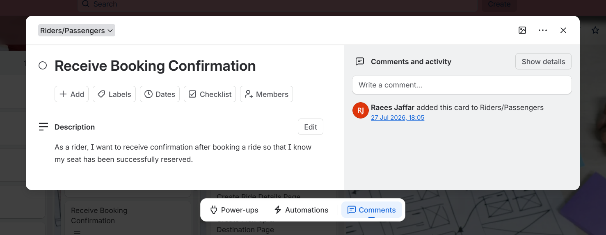
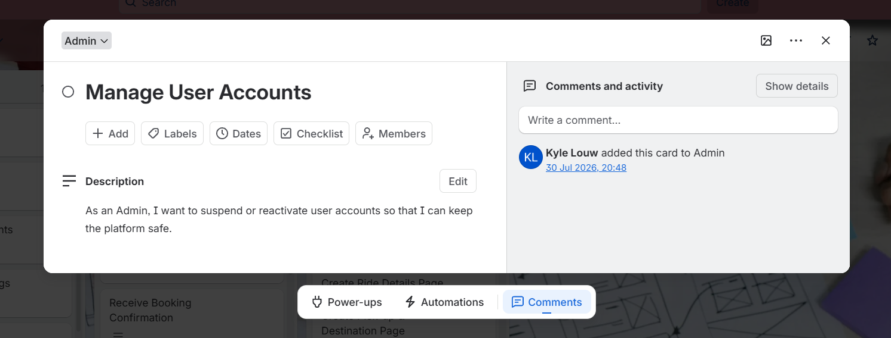
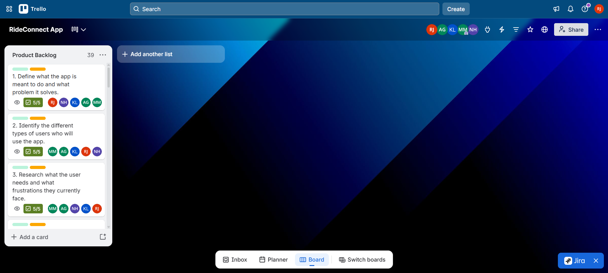
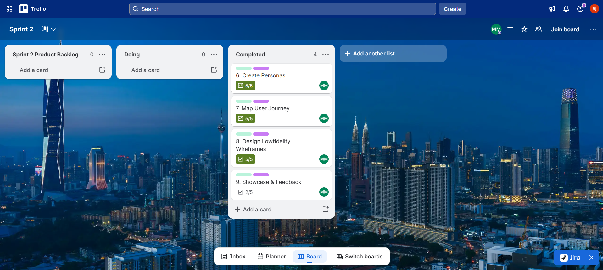
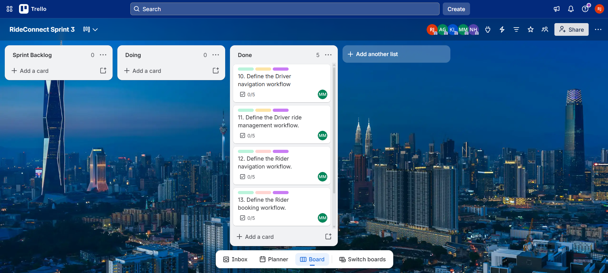
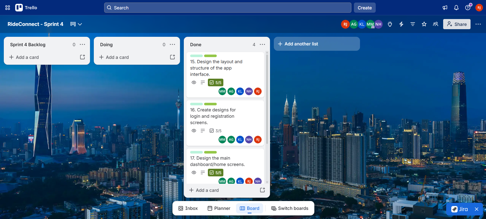

# Raees Jaffar

🎓 Multimedia Applications Student at Cape Peninsula University of Technology (CPUT)

📍 Cape Town, South Africa

---

## 📫 Contact Information

- 📧 [222668962@mycput.ac.za](mailto:222668962@mycput.ac.za)
- 📱 +27 76 228 3930
- 🔗 GitHub: [https://github.com/Ra-ees](https://github.com/Ra-ees)
- 🔗 LinkedIn: [https://linkedin.com/in/raeesjaffar](https://linkedin.com/in/raeesjaffar)

---

## 🧑‍💼 Professional Profile

I am currently studying Multimedia Applications at Cape Peninsula University of Technology (CPUT) as part of a Diploma in ICT programme. I have developed a strong understanding of digital design, multimedia production, and web development, enabling me to transform creative concepts into functional and visually appealing digital solutions for businesses and organisations.

My passion lies in technology, creativity, and innovation, and I continuously strive to produce high-quality work. I am adaptable and disciplined, possess excellent communication and interpersonal skills, and can work successfully both independently and within a team while adding value through my creativity and technical abilities.

---

## 🎓 Education

**Plumstead High School**  
National Senior Certificate  
2017–2021

**Cape Peninsula University of Technology (CPUT)**  
DIP: ICT IN MULTIMEDIA APPLICATIONS      
2023–2026

---

## 💼 Work Experience

### 👨‍💼 Academic Project Team Leader

**Cape Peninsula University of Technology** | 2023–Present

- Managed and organised the execution of multimedia and IT-based group projects across various course modules
- Developed project timelines by allocating necessary tasks to group members and ensuring all deliverables were met
- Created multimedia resources, including digital graphics, presentations, and promotional materials
- Produced procedural documentation such as technical outlines, proposals, and final reports
- Presented project deliverables to faculty and fellow students

---

### 🌐 Developed and Designed Web-Based Applications and Educational Resources (Academic Projects)

**Cape Peninsula University of Technology** | 2023–Present

- Developed websites using HTML, CSS, and JavaScript
- Applied UI/UX standards to improve user experience and accessibility
- Designed and implemented multimedia components to create interactive and visually appealing digital solutions
- Tested and revised designs to ensure usability and functionality

---

### 📱 Social Media Content Creator

**YouTube, TikTok, Instagram** | 2024–Present

- Developed and managed original digital content across multiple social media platforms
- Designed thumbnails, short-form videos, and visual assets aligned with platform trends
- Planned content strategies, captions, and posting schedules to increase audience engagement
- Analysed audience engagement to improve content performance and creative direction

---

## 🛠️ Technical Skills

- HTML
- CSS
- JavaScript
- Responsive Web Design
- Analytics Interpretation
- Canva
- Vector Graphic Design
- Video Editing
- Digital Image Manipulation
- Layout Design
- Microsoft Office (Word, Excel, Access, PowerPoint, Outlook)
- Content Creation
- UI Design
- Content Creation
- Graphic Design 
  
---

## 🧠 Soft Skills

- Strategic Planning
- Leadership
- Communication
- Teamwork
- Problem Solving
- Time Management
- Attention to Detail
- Adaptability
- Visual Communication
- Project Planning
- Critical Thinking
- Creativity

---

## 🤝 Volunteering Experience

### 🏡 Old Age Home Volunteer

- Assisted senior residents with daily activities and social interaction
- Demonstrated empathy, patience, and strong interpersonal communication skills
- Contributed positively to community well-being through service-based activities

---

### 🌱 Community Volunteer – Mowbray Cemetery

- Participated in community clean-up initiatives
- Assisted in environmental preservation and facility upkeep
- Supported organised volunteer activities

---

## 📚 References

**Shamil Khan**  
Events Coordinator  
Woodside Village for the Disabled  
📞 +27 66 203 8324

---

### 🎥 Mock Interview Video

<video width="640" controls>
  <source src="raees-jaffar-mock-interview.mp4" type="video/mp4">
  Your browser does not support the video tag.
</video>

---

## 🚗 RideConnect Agile Project Evidence

RideConnect is our team's carpooling application concept, intended to help commuters travelling to similar destinations share rides. The following evidence documents how the team agreed on its ways of working and organised project activities using Agile practices.

**Project management board:** [Open the RideConnect Trello invitation](https://trello.com/invite/b/69f78cbf0398c03c17eabecd/ATTI657e5dfee2fdce281e97298e4bc2c023507B7386/rideconnect-app)

### 1. Agile Team Charter

**Evidence:** [View the Agile Team Charter (Word document)](documents/agile-team-charter.docx)

**Reflection**

Reviewing our RideConnect team charter helped me understand the importance of agreeing on a shared goal, individual responsibilities and ways of working before and during development. The charter explains that our project aims to address commuting difficulties and traffic congestion in Cape Town through a carpooling platform. It also records our team roles, communication arrangements, meeting routines, decision-making approach, core values and definition of done. My listed role is backend developer, with responsibilities that include assisting with database setup, data validation and system logic. This helped me see how role clarity and shared expectations support coordination across a team. I also learned that identifying risks, such as integration difficulties and scope changes, gives a team a starting point for discussing how to manage them.

### 2. User Stories and Tasks

**Evidence:** [View the RideConnect User Stories Trello board](https://trello.com/invite/b/6a631fa858e2128dabc693d8/ATTIc45c2213c861ade283e4b745e42a28a9D9B645C3/userstories)

*User stories and associated tasks in Trello.*

**Reflection**

Working with user stories and tasks helped me understand the importance of breaking a project into smaller pieces of work based on what users need. For RideConnect, this approach helps the team consider the needs of people using the application while making the development work easier to organise. I also learned that tasks need to be clearly described so that team members understand their responsibilities and can work towards the same project goals.

### 3. Product Backlog

**Evidence:** [View the RideConnect Product Backlog Trello board](https://trello.com/invite/b/69f78cbf0398c03c17eabecd/ATTI657e5dfee2fdce281e97298e4bc2c023507B7386/rideconnect-app)

*Product backlog showing the planned product work.*

**Reflection**

The product backlog helped me understand how project requirements can be organised in one place and reviewed throughout development. It provides the team with a clearer view of the features and improvements that may be needed for RideConnect. I learned that keeping a backlog organised and prioritising work are important because a project can have several requirements, but the team must focus on the most important ones while working within its available time.
w
### 4. Sprint Backlog

**Evidence:**

[View the RideConnect Sprint 1 Trello board](https://trello.com/invite/b/6a6797344e221355b41ecac5/ATTI09fc132afbc094afee299f83a226780b994A1CA7/rideconnect-sprint-1)
[View the RideConnect Sprint 2 Trello board](https://trello.com/invite/b/6a67980fe2b435b92e2ae49f/ATTIe0029f897bcff88c7a99533ab1afeda848813B7E/rideconnect-sprint-2)
[View the RideConnect Sprint 3 Trello board](https://trello.com/invite/b/6a742c40f7f971fceaa6f3a1/ATTI0a76d77b7ee5ba56a69b0c37da3d6eab7BBB9DB7/rideconnect-sprint-3)
[View the RideConnect Sprint 4 Trello board](https://trello.com/invite/b/6a742f9df4528bf00e0ebb1a/ATTI9eb83b480e79ba541c57818d9053d4bcE22143C8/rideconnect-sprint-4)
[View the RideConnect Sprint 5 Trello board](https://trello.com/invite/b/6a7438593b5bdc98af986e22/ATTIde30f5f35d961763708b8f0742beb06fE97478C9/rideconnect-sprint-5)

*Sprint backlog showing the work planned for each sprint.*

**Reflection**

The sprint backlog helped me understand how selected work can be organised into manageable tasks for a specific development period. It connects the team's planned work with the progress that needs to be made during a sprint. I learned that tasks need to be realistic, clearly assigned and reviewed regularly so that the team can stay organised, identify possible difficulties and adjust when necessary. This approach supports better coordination and helps the team work towards its project objectives.

### 5. Agile Logbook

The following logbooks document my project activities, progress,
planning and reflections during the Entrepreneurial WIL Projects
from July to August 2026.

**Evidence:**

- [Agile Logbook – 14–17 July 2026](documents/agile-logbook-14-17-july-2026.docx)
- [Agile Logbook – 21–24 July 2026](documents/agile-logbook-21-24-july-2026.docx)
- [Agile Logbook – 28–31 July 2026](documents/agile-logbook-28-31-july-2026.docx)
- [Agile Logbook – 4–7 August 2026](documents/agile-logbook-4-7-august-2026.docx)

**Reflection**

Maintaining my Agile Logbook helped me track my progress and understand how different activities contributed to the development of our project. My entries cover several stages of the work, from reviewing project requirements and preparing a business case presentation to organising the Product Backlog in Trello, presenting our Figma prototype and working on the frontend functionality for RideConnect. They also record the preparation of our brand guide and the completion of required
documentation.

---

## 🪞 Reflective Learning

### 📄 Reflection on Coding in Markdown

As part of my portfolio development, I was required to convert my traditional CV into a GitHub README format using Markdown. My goal was to accurately translate all the information from my original CV into Markdown while improving its structure, readability, and presentation for an online platform. I learned and applied Markdown syntax, including headings, lists, links, and formatting techniques to structure the document effectively. I also refined the wording and layout to suit a GitHub portfolio, ensuring that the content remained professional while being visually clear and easy to navigate. I successfully created a well-structured and visually appealing Markdown CV that is both professional and suited for online viewing. This experience improved my attention to detail, strengthened my documentation skills, and enhanced my ability to present information in a digital format.

---

### 🎥 Reflection on Mock Interview Video Experience

As part of my career preparedness development, I was required to participate in and record a mock interview. My objective was to demonstrate my communication skills, confidence, and ability to present myself professionally in an interview setting. I prepared by reviewing common interview questions and reflecting on my skills, experiences, and goals. During the recording, I focused on speaking clearly, maintaining good posture, and presenting my responses in a structured and confident manner. After completing the interview, I reflected on my performance to identify areas for improvement. The experience helped me become more confident in presenting myself professionally and improved my verbal communication skills. It also highlighted the importance of preparation and self-awareness in interview situations, which will benefit me in future career opportunities.

---

### 🌐 Reflection on the Use of GitHub Pages

During the development of my portfolio, I was introduced to GitHub Pages as a platform to host and present my work online. My goal was to understand how GitHub Pages works and how it can be used to showcase my projects and professional profile in a structured and accessible way. I explored how repositories can be used to host web-based content and learned how to organise files effectively for online presentation. I applied this knowledge by structuring my portfolio in a clear and professional manner, ensuring that all content was accessible and easy to navigate. This experience enhanced my understanding of web hosting and digital portfolio development. It also gave me practical insight into how developers and multimedia professionals present their work online, which will be valuable as I continue to build my professional presence.
