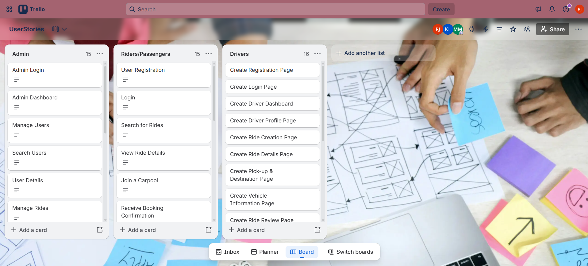
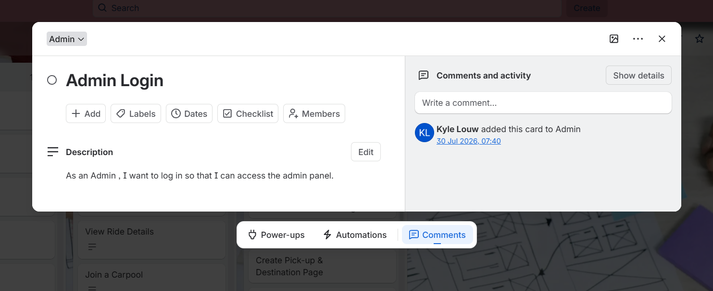

# Raees Jaffar

🎓 Multimedia Applications Student at Cape Peninsula University of Technology (CPUT)

📍 Cape Town, South Africa

---

## 📫 Contact Information

- 📧 [222668962@mycput.ac.za](mailto:222668962@mycput.ac.za)
- 📱 +27 76 228 3930
- 🔗 GitHub: [https://github.com/Ra-ees](https://github.com/Ra-ees)
- 🔗 LinkedIn: [https://linkedin.com/in/raeesjaffar](https://linkedin.com/in/raeesjaffar)

---

## 🧑‍💼 Professional Profile

I am currently studying Multimedia Applications at Cape Peninsula University of Technology (CPUT) as part of a Diploma in ICT programme. I have developed a strong understanding of digital design, multimedia production, and web development, enabling me to transform creative concepts into functional and visually appealing digital solutions for businesses and organisations.

My passion lies in technology, creativity, and innovation, and I continuously strive to produce high-quality work. I am adaptable and disciplined, possess excellent communication and interpersonal skills, and can work successfully both independently and within a team while adding value through my creativity and technical abilities.

---

## 🎓 Education

**Plumstead High School**  
National Senior Certificate  
2017 – 2021

**Cape Peninsula University of Technology (CPUT)**  
Diploma in ICT: Multimedia Applications  
2023 – 2026

---

## 💼 Work Experience

### 👨‍💼 Academic Project Team Leader

**Cape Peninsula University of Technology** | 2023 – 2026

- Managed and organised the execution of multimedia and IT-based group projects across various course modules
- Developed project timelines by allocating necessary tasks to group members and ensuring all deliverables were met
- Created multimedia resources, including digital graphics, presentations, and promotional materials
- Produced procedural documentation such as technical outlines, proposals, and final reports
- Presented project deliverables to faculty and fellow students

---

### 🌐 Developed and Designed Web-Based Applications and Educational Resources (Academic Projects)

**Cape Peninsula University of Technology** | 2023 – 2026

- Developed websites using HTML, CSS, and JavaScript
- Applied UI/UX standards to improve user experience and accessibility
- Designed and implemented multimedia components to create interactive and visually appealing digital solutions
- Tested and revised designs to ensure usability and functionality

---

### 📱 Social Media Content Creator

**YouTube, TikTok, Instagram** | 2024 – 2026

- Developed and managed original digital content across multiple social media platforms
- Designed thumbnails, short-form videos, and visual assets aligned with platform trends
- Planned content strategies, captions, and posting schedules to increase audience engagement
- Analysed audience engagement to improve content performance and creative direction

---

## 🛠️ Technical Skills

- HTML
- CSS
- Responsive Web Design
- Basic Analytics Interpretation
- Canva
- Vector Graphic Design
- Video Editing
- Digital Image Manipulation
- Layout Design
- Microsoft Office (Word, Excel, Access, PowerPoint, Outlook)
- Content Creation

---

## 🧠 Skills

- Graphic Design
- HTML
- CSS
- UI Design
- UX Principles
- Video Editing
- Content Creation
- Strategic Planning
- Leadership
- Communication
- Teamwork
- Problem Solving
- Time Management
- Attention to Detail
- Adaptability
- Visual Communication
- Project Planning
- Critical Thinking
- Creativity

---

## 🤝 Volunteering Experience

### 🏡 Old Age Home Volunteer

- Assisted senior residents with daily activities and social interaction
- Demonstrated empathy, patience, and strong interpersonal communication skills
- Contributed positively to community well-being through service-based activities

---

### 🌱 Community Volunteer – Mowbray Cemetery

- Participated in community clean-up initiatives
- Assisted in environmental preservation and facility upkeep
- Supported organised volunteer activities

---

## 📚 References

**Meagan Hamman**  
Multimedia Design Lecturer  
Cape Peninsula University of Technology  
📞 +27 21 460 9010

**Shamil Khan**  
Events Coordinator  
Woodside Village for the Disabled  
📞 +27 66 203 8324

---

### 🎥 Mock Interview Video

<video width="640" controls>
  <source src="raees-jaffar-mock-interview.mp4" type="video/mp4">
  Your browser does not support the video tag.
</video>

---

## 🚗 RideConnect Agile Project Evidence

RideConnect is our team's carpooling application concept, intended to help commuters travelling to similar destinations share rides. The following evidence documents how the team agreed on its ways of working and organised project activities using Agile practices.

**Project management board:** [Open the RideConnect Trello invitation](https://trello.com/invite/b/69f78cbf0398c03c17eabecd/ATTI657e5dfee2fdce281e97298e4bc2c023507B7386/rideconnect-app)

### 1. Agile Team Charter

**Evidence:** [View the Agile Team Charter (Word document)](documents/agile-team-charter.docx)

**Reflection**

Reviewing our RideConnect team charter helped me understand the importance of agreeing on a shared goal, individual responsibilities and ways of working before and during development. The charter explains that our project aims to address commuting difficulties and traffic congestion in Cape Town through a carpooling platform. It also records our team roles, communication arrangements, meeting routines, decision-making approach, core values and definition of done. My listed role is backend developer, with responsibilities that include assisting with database setup, data validation and system logic. This helped me see how role clarity and shared expectations support coordination across a team. I also learned that identifying risks, such as integration difficulties and scope changes, gives a team a starting point for discussing how to manage them.

### 2. User Stories and Tasks

**Evidence:** [View the RideConnect Trello board](https://trello.com/invite/b/6a631fa858e2128dabc693d8/ATTIc45c2213c861ade283e4b745e42a28a9D9B645C3/userstories)

**Reflection**

*To be completed after reviewing the Trello screenshots and the user stories and tasks recorded by the team.*

### 3. Product Backlog

**Evidence:** [View the RideConnect Trello board](https://trello.com/invite/b/69f78cbf0398c03c17eabecd/ATTI657e5dfee2fdce281e97298e4bc2c023507B7386/rideconnect-app)

*Screenshots showing the product backlog will be added here.*

**Reflection**

*To be completed after reviewing the product backlog screenshots and the priorities recorded by the team.*

### 4. Sprint Backlog

*Screenshots showing the sprint backlog and planned sprint tasks will be added here.*

**Reflection**

*To be completed after reviewing the sprint backlog screenshots and the work planned for each sprint.*

### 5. Agile Logbook

**Evidence:** [View the Agile Logbook (Word document)](documents/agile-logbook.docx)

**Reflection**

My Agile logbook records project activities and plans for 3–7 August 2026. The entries cover online classes, work on the RideConnect application, preparation and presentation of the Trello board, work on the brand guide, and completion of a monthly report and registration form. Each daily entry uses the questions about completed work, planned work and impediments to structure the record. Keeping this information helped me recognise the value of making progress, next steps and challenges visible rather than relying on memory. The entries also show the need to plan around presentations and submission tasks, and to manage time when several activities must be completed close together. I learned that a logbook can support accountability and provide a record that the team can refer back to when reviewing project progress.

---

## 🪞 Reflective Learning

### 📄 Reflection on Coding in Markdown

As part of my portfolio development, I was required to convert my traditional CV into a GitHub README format using Markdown. My goal was to accurately translate all the information from my original CV into Markdown while improving its structure, readability, and presentation for an online platform. I learned and applied Markdown syntax, including headings, lists, links, and formatting techniques to structure the document effectively. I also refined the wording and layout to suit a GitHub portfolio, ensuring that the content remained professional while being visually clear and easy to navigate. I successfully created a well-structured and visually appealing Markdown CV that is both professional and suited for online viewing. This experience improved my attention to detail, strengthened my documentation skills, and enhanced my ability to present information in a digital format.

---

### 🎥 Reflection on Mock Interview Video Experience

As part of my career preparedness development, I was required to participate in and record a mock interview. My objective was to demonstrate my communication skills, confidence, and ability to present myself professionally in an interview setting. I prepared by reviewing common interview questions and reflecting on my skills, experiences, and goals. During the recording, I focused on speaking clearly, maintaining good posture, and presenting my responses in a structured and confident manner. After completing the interview, I reflected on my performance to identify areas for improvement. The experience helped me become more confident in presenting myself professionally and improved my verbal communication skills. It also highlighted the importance of preparation and self-awareness in interview situations, which will benefit me in future career opportunities.

---

### 🌐 Reflection on the Use of GitHub Pages

During the development of my portfolio, I was introduced to GitHub Pages as a platform to host and present my work online. My goal was to understand how GitHub Pages works and how it can be used to showcase my projects and professional profile in a structured and accessible way. I explored how repositories can be used to host web-based content and learned how to organise files effectively for online presentation. I applied this knowledge by structuring my portfolio in a clear and professional manner, ensuring that all content was accessible and easy to navigate. This experience enhanced my understanding of web hosting and digital portfolio development. It also gave me practical insight into how developers and multimedia professionals present their work online, which will be valuable as I continue to build my professional presence.
